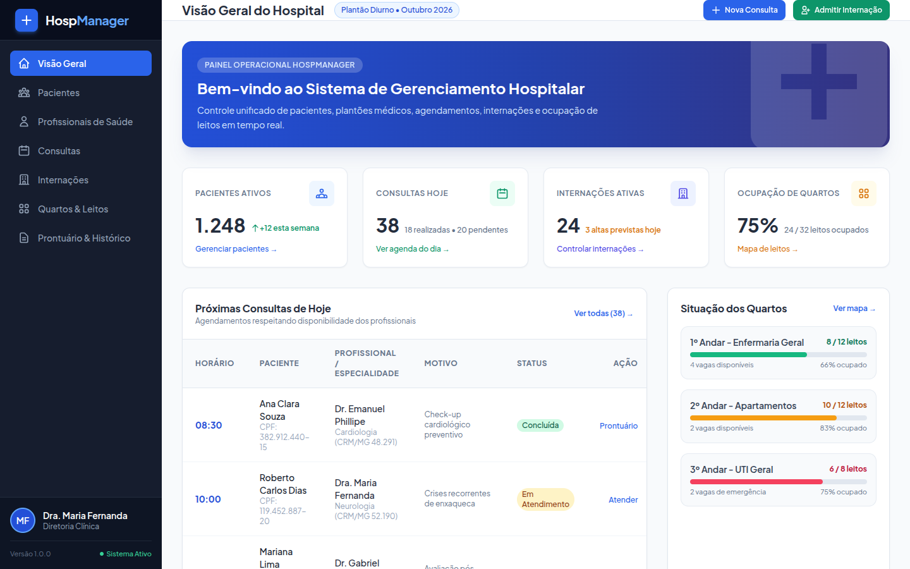
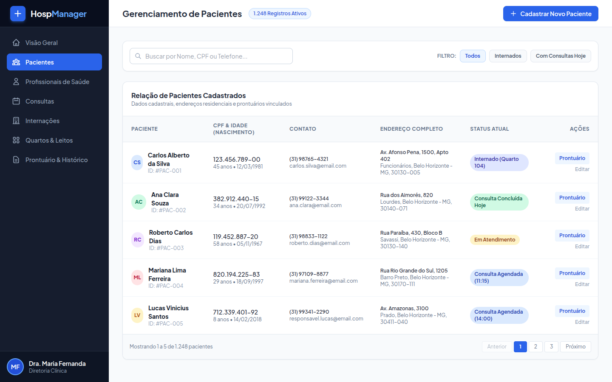
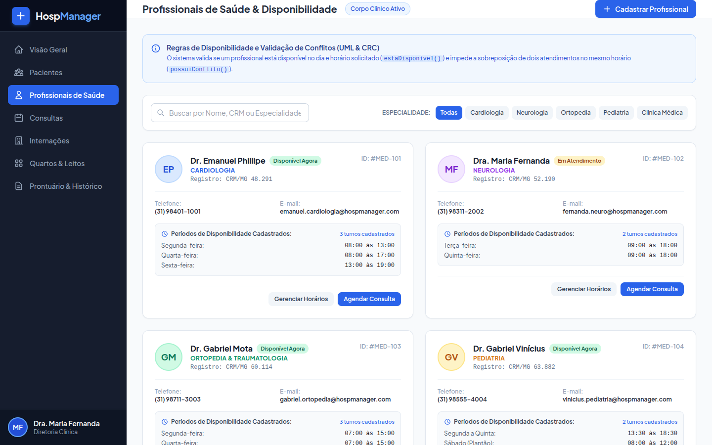
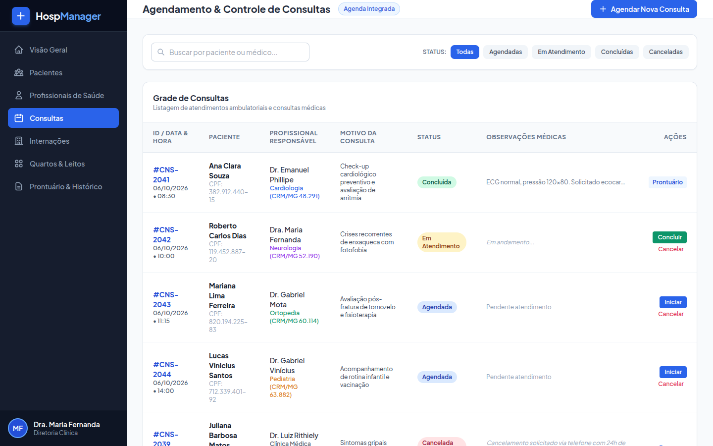
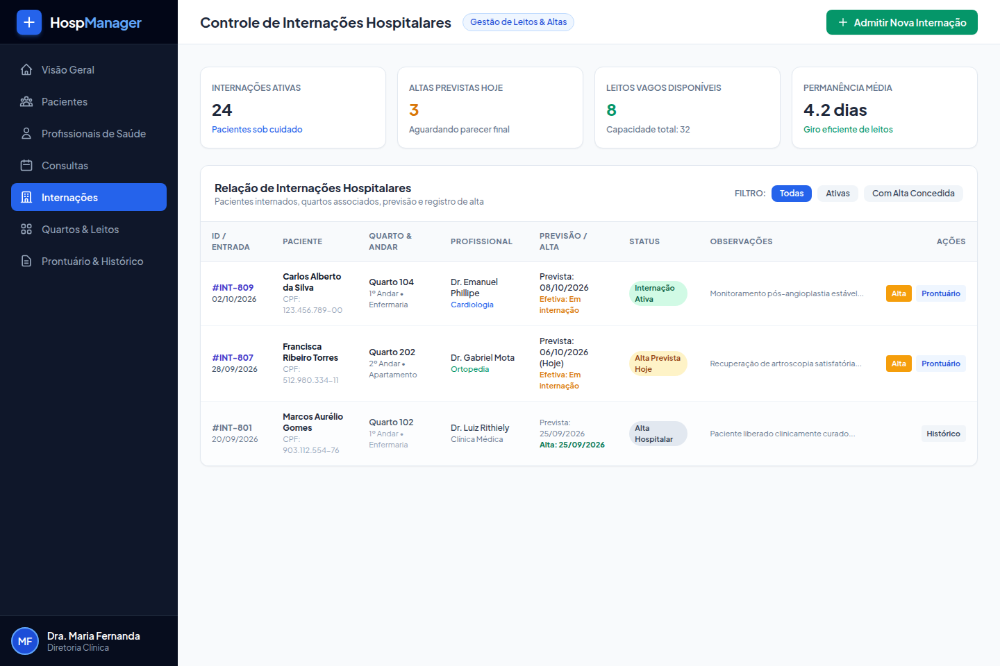
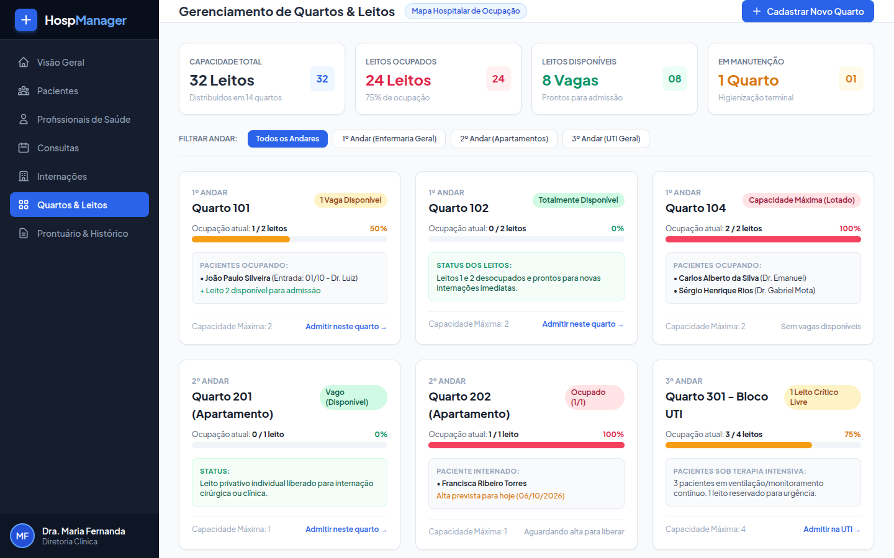
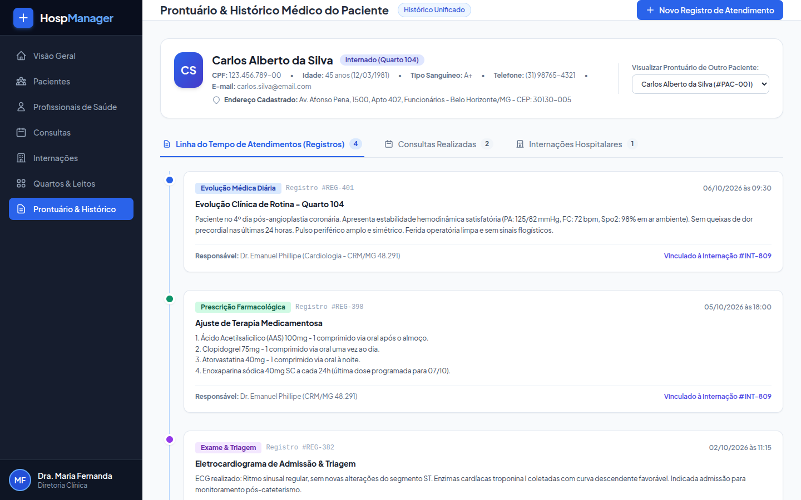

# HospManager - Sistema de Gerenciamento Hospitalar

> **Trabalho Prático - Programação Modular**  
> **Pontifícia Universidade Católica de Minas Gerais (PUC Minas)**  
> **Bacharelado em Engenharia de Software**

---

## Integrantes da Equipe

- Emanuel Phillipe Ribeiro Ferreira Carvalho
- Gabriel Mota Valério
- Gabriel Vinícius Soares Doti
- Luiz Rithiely Barbosa Silva
- Maria Fernanda Melo e Reis

---

## Sobre o Projeto

O **HospManager** é uma solução completa desenvolvida para suprir as demandas administrativas e clínicas de um hospital de médio porte, substituindo controles manuais por um fluxo informatizado e integrado. 

O sistema centraliza e padroniza as operações diárias de gestão de saúde, com foco em:
- Redução de erros operacionais em agendamentos e ocupações;
- Controle rigoroso de regras de negócio, tais como prevenção de conflitos de horários em consultas médicas e garantia de capacidade máxima de leitos por quarto hospitalar;
- Centralização de prontuários médicos e históricos de atendimento, unificando consultas ambulatoriais, internações e evoluções clínicas por paciente.

A arquitetura e o modelo conceitual do sistema foram projetados a partir de Modelagem Orientada a Objetos (POO), apoiada por diagramas de classes UML e cartões CRC (*Classe – Responsabilidade – Colaboração*).

---

## Stack de Tecnologias Utilizada (Att. 06/09)

Até a presente etapa do projeto, a stack tecnológica compreende:

| Camada / Finalidade | Tecnologia | Descrição |
| :--- | :--- | :--- |
| **Framework Backend** | **Spring Boot 4.1.1** | Ecossistema corporativo com arquitetura em camadas (Controller, Service, Repository, Model). |
| **Template Engine** | **Thymeleaf** | Mecanismo de renderização de páginas HTML integrado ao ecossistema Spring. |
| **Módulos Spring** | **Spring Web MVC & Spring Security** | Tratamento de requisições web, roteamento e base de autenticação e autorização. |
| **Frontend & Estilização** | **HTML5 Semântico & Tailwind CSS** | Interface moderna, responsiva, padronizada e limpa baseada em design system utilitário via CDN. |

---

## 🖥️ Telas do Sistema (Screenshots)

### 1. Visão Geral (Dashboard)
Painel com indicadores operacionais em tempo real (pacientes ativos, consultas do dia, taxa de ocupação dos leitos), próximos agendamentos e médicos de plantão.

---

### 2. Gerenciamento de Pacientes
Tabela com dados pessoais, CPFs, idades calculadas, endereços formatados e status clínico atual, além de modal completo para cadastro de novos pacientes.

---

### 3. Profissionais de Saúde & Disponibilidade
Listagem do corpo clínico por especialidade, exibição de registros (CRM/COREN), horários de disponibilidade semanais e modais para configuração de escalas e novos cadastros.

---

### 4. Agendamento & Controle de Consultas
Grade de consultas com filtros de status (Agendadas, Em Atendimento, Concluídas, Canceladas), modal de agendamento com validação de conflitos e modal para conclusão médica com prescrição.

---

### 5. Controle de Internações Hospitalares
Gestão de internações ativas e histórico de altas, associação com médicos e quartos, e fluxo para registrar data efetiva de alta com liberação automática de leitos.

---

### 6. Gerenciamento de Quartos & Leitos
Mapa visual de leitos por andar (Enfermaria Geral, Apartamentos e UTI), cálculo de porcentagem de ocupação, indicação de vagas livres e modal para criação de novos quartos.

---

### 7. Prontuário & Histórico Médico
Prontuário unificado do paciente contendo seletor de pacientes, perfil completo e abas navegáveis: Linha do Tempo de Atendimentos (`RegistroAtendimento`), Consultas Realizadas e Histórico de Internações.

